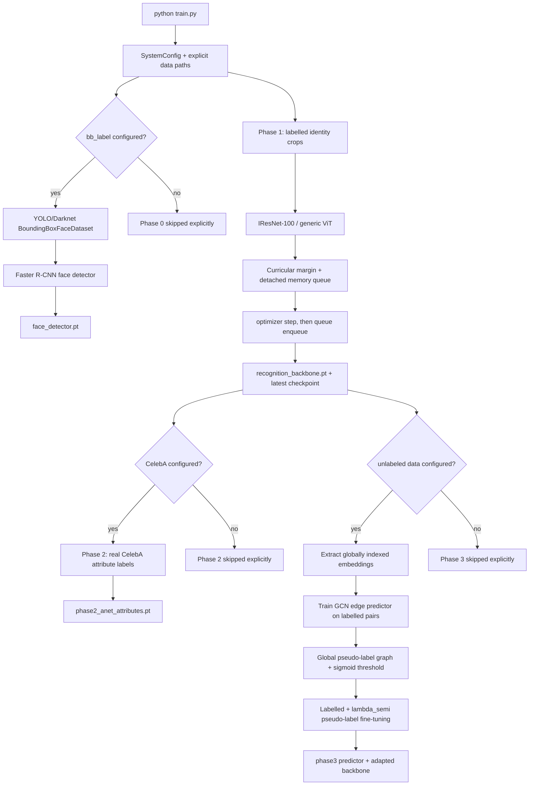

# Training execution graph

This file describes the current executable training flow. Optional inference
modules are not implicitly inserted into identity training.



## Phase 0

`train_phase0_face_detector()` loads the configured AQUA `bb_label` directory.
YOLO rows are converted to pixel-space torchvision targets, all foreground
classes are mapped to the common `face` class, and a class-agnostic Faster
R-CNN is optimized with the real boxes. If an explicit `train` directory is
present, that split plus unsplit AQUA layouts are used; explicit test/validation
folders are excluded. Otherwise the available labelled layout is scanned. The
completed `face_detector.pt` checkpoint is reused on later runs
unless `--retrain_all` is supplied.

This phase trains localization. It does not turn detection boxes into identity
classes; identity recognition remains the separate `name_label` Phase 1.

## Phase 1

`train_phase1_backbone_curricular()` loads `NameLabeledFaceDataset` and fails
if the path is missing or empty. It does not instantiate a detector, random
SAM mask, or random frontalizer. The images are expected to be identity-
labelled face crops and are normalized by the shared dataset transform.

The DDP wrapper contains both the backbone and the Curricular/BroadFace
classifier. This keeps classifier parameters synchronized. Queue examples are
enqueued after `optimizer.step()` and gathered across ranks.

The checkpoint includes:

* backbone state;
* Curricular/BroadFace state including EMA and queue;
* optimizer, scheduler, and scaler state;
* model/loss configuration;
* class-to-index mapping;
* epoch and schema version.

## Phase 2

`CelebAAttributeDataset` reads only real CelebA attribute annotations. It does
not assign random attributes to wild images and does not use synthetic
occlusion rectangles as segmentation targets. Phase 2 is skipped if no CelebA
directory is supplied.

## Phase 3

The optional graph phase extracts embeddings for the complete unlabeled stream,
trains the edge predictor from labelled identity pairs, and generates pseudo
labels with globally unique IDs. Small graphs use the learned edge head; large
graphs use the blockwise nonnegative graph path to avoid an `N x N x hidden`
allocation. The final adaptation uses both labelled and pseudo-labelled data
with `lambda_semi` and saves the adapted backbone.

## Inference graph

```text
image
   -> trained AQUA detector when face_detector.pt is loaded,
      otherwise YuNet/MTCNN
  -> Soft-NMS with source indices
  -> five-point similarity alignment
  -> optional checkpointed mask/attributes/frontalizer
  -> embedding backbone
  -> enrollment dictionary and sparse residual gate
  -> result per detected face
```

No-face output is `[]`. A full-image positive fallback is not part of the
current contract.
